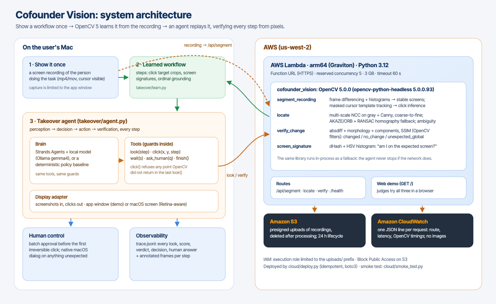

# Cofounder Vision

**Show a workflow once. An agent takes it over, and checks every step with OpenCV 5.**

OpenCV AI Competition 2026 (powered by AWS) · Featured path: **Agentic Vision** · Team: Oren Chriqui (solo)

- **Live web endpoint (AWS Lambda, arm64 / Graviton, OpenCV 5.0.0):** https://emmbbwhapidhsug3egofquuada0bqmel.lambda-url.us-west-2.on.aws/
- **Technical report:** [`report/Cofounder-Vision-Technical-Report.pdf`](report/)
- **Architecture:** [`docs/opencv-architecture.png`](docs/opencv-architecture.png) · **Agent workflow:** [`docs/agent-loop.png`](docs/agent-loop.png)



## What it does
1. **Learn from one recording.** `segment_recording` (OpenCV 5) turns a screen recording into steps:
   - stable screens come from frame differencing and histograms;
   - the cursor is tracked by masked template matching;
   - a click is inferred from a cursor dwell followed by a local change;
   - each step keeps a crop of the clicked control.
2. **See before acting.**
   - `locate`: multi-scale NCC on gray and Canny edges, ORB + RANSAC homography fallback, and an ambiguity test.
   - `locate_all`: ordinal grounding, for example "the 1st of the identical Review buttons, as demonstrated".
3. **Check after acting.**
   - `verify_change`: absdiff + morphology + SSIM, with the verdict `changed`, `no_change` or `unexpected_global`;
   - the effect is also compared with the demonstration's effect.
4. **Agentic loop.** A Strands Agents LLM (local model) or a deterministic policy calls the tools `look`, `click`, `wait`, `ask_human` and `finish`.
   - **Guards in the tools:** `click()` refuses coordinates OpenCV did not return, and a batch approval is required before irreversible clicks.
   - **The visual evidence changes the next action:** `no_change` → wait and re-check; an unexpected dialog → ask the human; nothing found → re-look, then escalate.
   - **Everything is traced** in `trace.jsonl`, with annotated frames.

## Layout
| Path | Contents |
|---|---|
| `vision/` | `cofounder_vision`, the OpenCV 5 library (pinned `opencv-python-headless==5.0.0.93`, `numpy==2.2.6`), plus tests and the benchmark (`eval/RESULTS.md`) |
| `cloud/` | AWS Lambda handler, web demo, idempotent deploy (`deploy.py`), smoke test (28 checks) |
| `takeover/` | learning (`learn.py`), agent (`agent.py`), display adapters, evaluation (`evaluate.py`, `eval/AGENT_RESULTS.md`) |
| `demo-app/` | Ledgerly, the accounts-payable demo app and its pixel-only "virtual display", plus the demonstration recording |

## Quick start
```bash
# Perception library: tests and benchmark
cd vision && uv sync && uv run python -m pytest -q && uv run python eval/run_eval.py
# Web endpoint: open the URL above, then try "Learn from a recording", "Find on screen" and "Did it work?" with the samples
# AWS deploy (your account): uv run --with boto3 python cloud/deploy.py && python3 cloud/smoke_test.py
# Agent on the demo app (needs Node and Electron; Ollama gemma4:e2b for the LLM brain)
npx electron demo-app/window.cjs &
cd takeover && uv sync
uv run python learn.py ../demo-app/recordings/approve-invoice.mp4
uv run python agent.py --brain policy --runs 6 --query "reset=1&done=INV-2041"
uv run python evaluate.py --brains policy,llm
```

## Results
See [`vision/eval/RESULTS.md`](vision/eval/RESULTS.md) and [`takeover/eval/AGENT_RESULTS.md`](takeover/eval/AGENT_RESULTS.md). The report discusses the failure cases.

## Responsible use
- Only the target app window is captured.
- Uploads are deleted after processing (24 h S3 lifecycle as a backstop).
- Logs contain no images.
- A human approves irreversible actions, and every unexpected screen goes to the human.

## License
MIT
