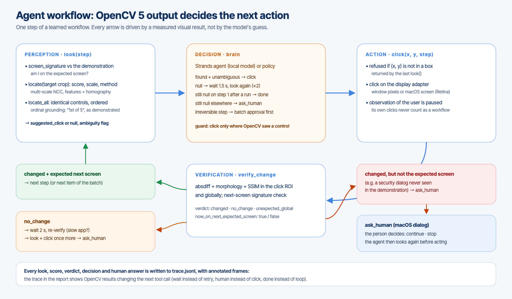

# Cofounder Vision

## Show a workflow once. An agent takes it over, and checks every step with OpenCV 5.

**OpenCV AI Competition 2026 (powered by AWS) · Technical report**
Team: Oren Chriqui (solo) · Featured path: Agentic Vision · Repository: https://github.com/chessoren/cofounder-vision
Live endpoint: {{ENDPOINT}}

---

## 1. Problem and users

Office work is full of short, repetitive screen workflows. An accounts-payable clerk, for example, opens an invoice,
matches it to its purchase order and approves it, thirty times a morning. Automation tools exist, but they start from a
specification: *"what do you want to automate?"* Writing one takes longer than doing the task. Scripts that replay recorded
click coordinates break as soon as a window moves, the display scale changes or a dialog appears, and they usually fail
silently.

**Users.** Freelancers, bookkeepers, recruiters and operations staff. They live in a browser and a few SaaS tools, and
no engineer will write automations for them.

**Cofounder Vision** asks for no specification. The person records the task once. OpenCV 5 turns the recording into
steps, and an agent replays them on the live screen. Before every click it checks, with OpenCV, that it sees what the
person saw. After every click it checks that the screen reacted the way it should. When the visual evidence says
something is off, the agent changes what it does next: it waits, re-looks, or hands control back to the human.

## 2. System overview


The system has three parts:

1. **Learning.** `takeover/learn.py` uploads the recording to the vision service (S3 presigned PUT) and calls
   `/api/segment`. The result is a workflow: for each click, a crop of the clicked control, the full frame just
   before the click, and an *ordinal grounding* record. If the clicked control is one of several identical controls
   (a "Review" button on every row), the record says which one, counted top to bottom.
2. **Perception service** (`vision/`, deployed by `cloud/`). An OpenCV 5 library served by AWS Lambda on Graviton
   (arm64) behind a public Function URL, which also hosts the interactive web demo.
3. **Takeover agent** (`takeover/agent.py`). A perception → decision → action → verification loop with five tools.
   It is driven either by a Strands Agents LLM agent (local model through Ollama) or by a deterministic policy baseline
   that implements the same rules. The agent only receives pixels and can only act through those tools.

## 3. OpenCV 5 implementation

All perception uses **OpenCV 5.0.0** (`opencv-python-headless==5.0.0.93`, numpy pinned), with no contrib modules.
The same code runs on Lambda arm64 and in-process; the local copy is the agent's fallback when the network is down.

| Function | What it does | OpenCV 5 building blocks |
|---|---|---|
| `segment_recording` | recording → steps (click / type) | `VideoCapture`, frame `absdiff` ratio + HSV histogram correlation with hysteresis for stable screens; masked arrow-cursor template matching (`matchTemplate` with a mask) to track the cursor; click = dwell ≥ 150 ms followed by a local change near the cursor tip |
| `locate` | finds a learned control on a new screen | coarse-to-fine multi-scale `TM_CCOEFF_NORMED` on gray + Canny edges (scales 0.5–2.0); ambiguity test on the second peak after suppression; fallback AKAZE/ORB + ratio test + RANSAC `findHomography` (≥ 8 inliers) |
| `locate_all` | every identical control, ordered | multi-scale NCC + iterative non-maximum suppression |
| `verify_change` | did the action work? | `absdiff`, Gaussian blur, threshold, morphology, `connectedComponentsWithStats`; SSIM computed with OpenCV filters; verdict `changed` / `no_change` / `unexpected_global` |
| `screen_signature` | am I on the expected screen? | 64-bit difference hash (`resize`) + HSV histogram (`calcHist`, `compareHist`) |

{{VISION_DETAILS}}

## 4. The agentic loop (Agentic Vision path)



**Tools.** The agent has five tools:

| Tool | What it does |
|---|---|
| `look(step)` | screen-signature check, `locate` + `locate_all`, suggested click |
| `click(x, y, step)` | the action, followed by `verify_change` and a next-screen signature check |
| `wait(s)` | pauses, then reports what changed since the last click |
| `ask_human(question)` | hands control to the person |
| `finish(status, why)` | ends the run |

**The visual evidence decides the next call:**

- *Target not found:* wait and re-look, twice. If still nothing at step 1 after a completed run, the job is done; elsewhere the agent escalates to the human.
- *`no_change` after a click:* the agent waits and re-verifies before any retry, because the app may simply be slow. A retry happens once at most, then the agent escalates.
- *Changed, but not to the expected next screen* (a dialog never seen in the demonstration): the agent asks the human, then looks again before acting.

**Guards in the tools, not in the prompt.** `click()` refuses any coordinate that is not inside a control OpenCV returned in
the last `look()`, so neither the model nor a bug can click somewhere unseen. Before the first irreversible action
(*Approve*), the agent asks once for a batch approval. Every look, score, verdict, decision and human answer is written to
`trace.jsonl`, together with an annotated frame.

{{TRACE_EXCERPT}}

## 5. AWS deployment

| Component | Configuration |
|---|---|
| AWS Lambda | `cofounder-vision`, **arm64 (Graviton)**, Python 3.12, 3008 MB, 60 s timeout, reserved concurrency 5 (abuse and cost guard), Function URL (HTTPS) |
| Package | built without Docker from pinned manylinux aarch64 wheels (`cloud/build.py`); `/health` reports the OpenCV version and CPU architecture at runtime |
| Amazon S3 | temporary uploads through presigned PUT, Block Public Access, SSE-S3, objects deleted after processing plus a 24 h lifecycle rule |
| Amazon CloudWatch | one structured JSON log line per request (route, status, latency, OpenCV timings, sizes); no images, no IPs; 14-day retention |
| IAM | execution role = basic logging + access limited to the `uploads/` prefix of the bucket |
| Repeatability | `uv run --with boto3 python cloud/deploy.py` (idempotent create-or-update) and `cloud/smoke_test.py` |

{{CLOUD_DETAILS}}

## 6. Evaluation

### 6.1 Perception benchmark (`vision/eval/run_eval.py`)

{{VISION_RESULTS}}

### 6.2 Agent evaluation (`takeover/evaluate.py`)

The agent runs against **Ledgerly**, a small accounts-payable app built for this evaluation, under fault injection.
Success is read from the app's own final state, not from the agent's claims. The demonstration recording is 12.5 s
long and contains 3 clicks.

| Scenario | What changes compared with the demonstration |
|---|---|
| clean | 5 invoices left to approve |
| zoom125 | the whole UI is rendered 25 % larger |
| slow | "Match PO" responds after 2.5 s |
| modal | a security dialog interrupts every approval |
| disabled | "Approve" never becomes enabled on one invoice |

{{AGENT_RESULTS}}

### 6.3 Failure cases

{{FAILURES}}

## 7. Limitations

- **Click-based workflows only.** Typed text is detected as a "type" step, but the agent does not yet know *what* to type for a new item: that needs OCR or a vision-language model.
- **One demonstration per workflow.** Controls whose appearance changes a lot between items (dynamic labels) defeat template matching; the features fallback helps only on textured controls.
- **Interpreting surprises is delegated.** The agent detects unexpected screens reliably, but it does not interpret them: it asks the human. That is a deliberate choice, but it limits autonomy.
- **Synthetic demonstration.** The demonstration in the evaluation is performed by a scripted demonstrator and recorded from the app window with a recorder-drawn cursor. Real macOS screen recordings are supported (the masked cursor tracking also handles the system cursor), but they are not part of the benchmark.
- **The language model is local.** The LLM brain runs a small local model (Ollama) because Amazon Bedrock model access was not available on our AWS account during the competition. The deterministic policy implements the same rules and is the evaluation baseline.

## 8. Responsible use

- **Privacy.** Only the target app's window is captured. The agent never sees other apps, notifications or the desktop. Uploads are deleted after processing; nothing is stored or used for training. Logs contain no image data.
- **Human control.** The batch approval protects irreversible actions. Anything unexpected goes to the human, never to a guess. Stop is always available, and the human can also stop the agent by moving the mouse to a screen corner (pyautogui fail-safe) on the real-screen adapter.
- **No invented clicks.** Coordinates must come from OpenCV detections, as enforced in `click()`.
- **Honest reporting.** Every number in this report is produced by the scripts in the repository and can be regenerated.

## 9. Reproduce

```
git clone https://github.com/chessoren/cofounder-vision && cd cofounder-vision
cd vision && uv sync && uv run python -m pytest -q && uv run python eval/run_eval.py          # perception benchmark
cd ../cloud && uv run --with boto3 python deploy.py && uv run --with boto3 python smoke_test.py # AWS (your account)
npx electron ../demo-app/window.cjs &                                                         # the target app
cd ../takeover && uv sync && uv run python learn.py ../demo-app/recordings/approve-invoice.mp4
uv run python evaluate.py --brains policy,llm                                                 # agent evaluation
```

## 10. Disclosure

Cofounder is a macOS agent project that the author started before this competition. It includes an Electron desktop app,
an activity observer and a workflow-memory agent. **Everything described in this report was built for the OpenCV AI
Competition 2026:**

- the OpenCV 5 library (`vision/`);
- the AWS Lambda service and web demo (`cloud/`);
- the learning step and the takeover agent (`takeover/`);
- the evaluation app and harness (`demo-app/`, `takeover/evaluate.py`).

AI coding assistants were used during development. The agentic workflow evaluated here is the product's runtime loop,
not the use of a coding assistant.
